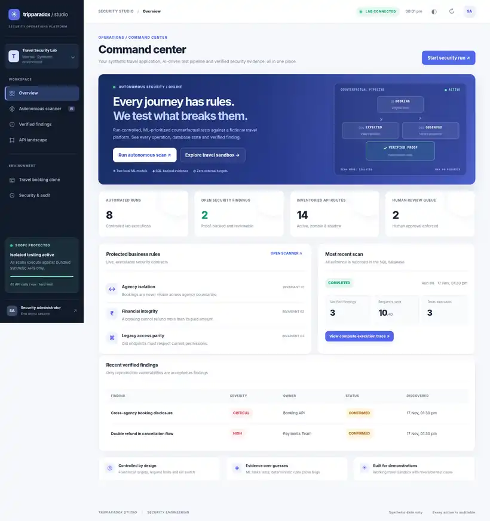
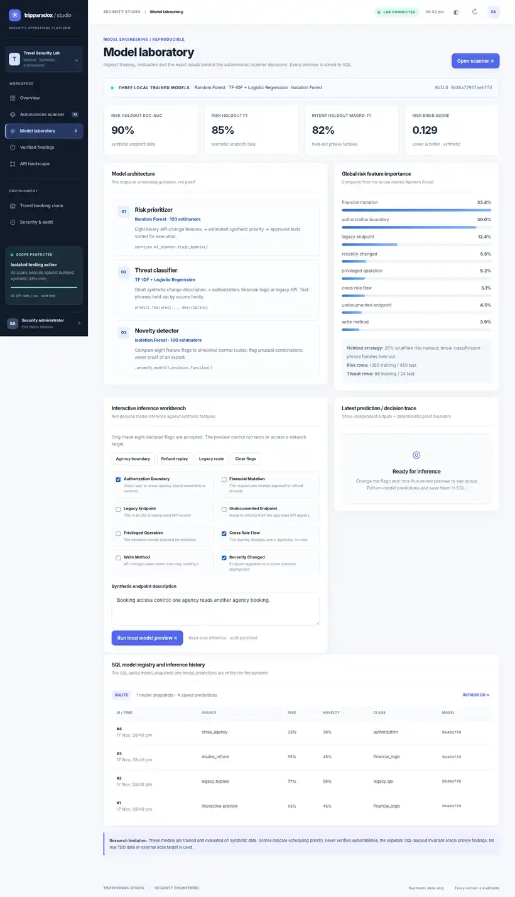
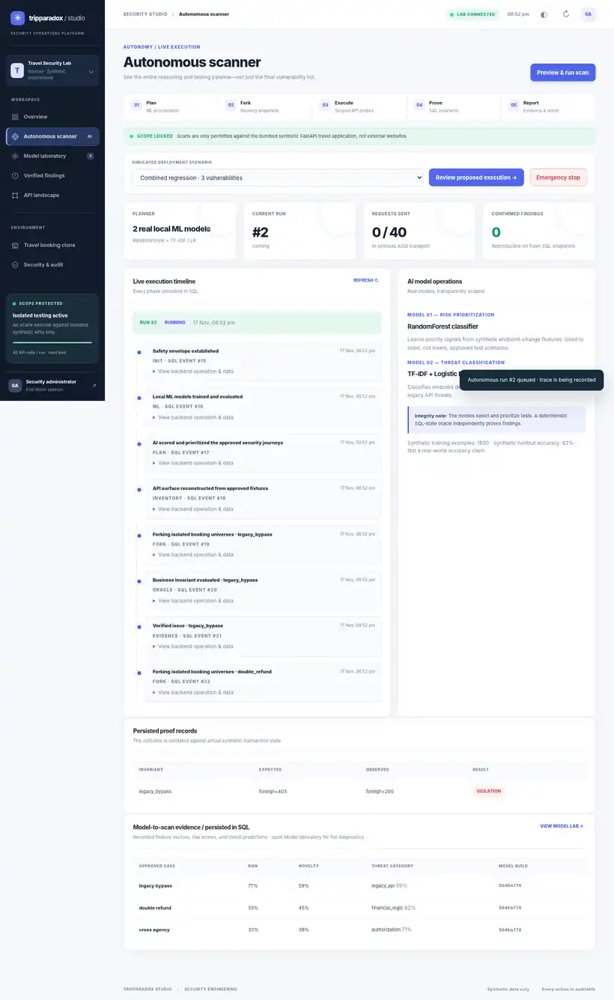
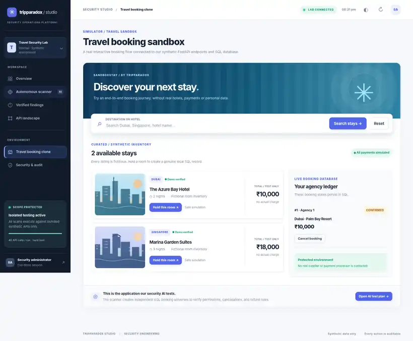
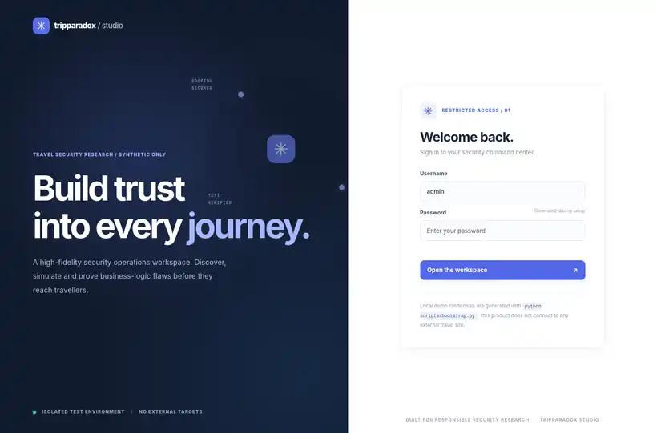

# Voyage_Hack — TripParadox AI

**AI-assisted, evidence-driven security testing for synthetic B2B travel systems.**



## Interface screenshots

| Command center | AI Model Laboratory |
|:---:|:---:|
|  |  |

| Automated security scanner | Travel booking simulator |
|:---:|:---:|
|  |  |



> **Scope:** A strictly local synthetic security research lab. Deliberately planted vulnerabilities are disabled by default and must not be exposed to public hosts. This is not a real TBO platform integration, production security certificate, or zero-vulnerability guarantee.

## What it does

- Scores approved security checks with **three local sklearn models** (Random Forest risk prioritizer, TF-IDF/Logistic Regression threat classifier, Isolation Forest novelty estimator).
- Generates fictional booking universes, sends controlled **in-process** HTTP requests to a synthetic travel app, and validates business invariants against saved SQL state.
- Checks cross-agency booking access, duplicate refund limits, and legacy API authorization parity.
- Confirms suspected findings on fresh booking clones, saves SQL evidence, assigns review tickets, and retests fixes.
- Presents all workflows in a responsive frontend, with model scores, backend execution stages, findings, API inventory, booking flows, and security controls.
- Uses **SQLite locally**, with a **PostgreSQL 17 + Docker Compose configuration** available for deployment.

## Quick start

```bash
python scripts/bootstrap.py
python -m pip install -r backend/requirements-dev.txt
python scripts/run_backend.py
```

Visit **http://127.0.0.1:8000/lab**. Bootstrap creates local ignored credentials.

### PostgreSQL / Docker

```bash
python scripts/bootstrap.py  # only if .env does not already exist
docker compose up --build -d
```

Check **http://127.0.0.1:8000/health/db**. A PostgreSQL response indicates DB connectivity. Container deployment has not been live-certified in the release environment.

### Testing

```bash
cd backend
python -m pytest tests -q
```

The archived hardened release recorded **56 passing backend tests** plus repeated synthetic secure/vulnerable scans. These cover the implemented scenarios—not all possible vulnerabilities.

## Documentation

- [Full technical and security report](docs/COMPREHENSIVE_SECURITY_TECHNICAL_REPORT.md)
- [Security hardening report](docs/RELEASE_SECURITY_REPORT.md)
- [ML models and training](docs/MODEL_ENGINEERING_DEEP_DIVE.md)
- [PostgreSQL database setup](docs/POSTGRESQL_SETUP.md)
- [Architecture](docs/ARCHITECTURE.md)
- [Safety and threat model](docs/THREAT_MODEL.md)
- [Full demonstration script](docs/DEMO_SCRIPT.md)

## License and references

MIT. The visual structure takes inspiration from the MIT-licensed [Tabler](https://github.com/tabler/tabler) project, but the app's styling, interface, travel illustrations, and source implementation are included locally. No proprietary travel website was cloned or scraped.

---

<details>
<summary>Detailed original technical README</summary>


This version passed **56 backend tests, three separate repeated release-gate cycles, an actual Chromium frontend workflow, and a real local Uvicorn restart test**. It is still a **synthetic security research simulator**, not a proven zero-vulnerability application. Read [`docs/RELEASE_SECURITY_REPORT.md`](docs/RELEASE_SECURITY_REPORT.md) before deployment.

**Secure by default:** `TP_ALLOW_INTENTIONAL_FLAWS=false`. The three deliberately planted vulnerable modes are **blocked** unless a local operator explicitly opts in at process startup. The secure configuration is checked at boot, including clearing vulnerable flags accidentally left in an older demo database. The application must **never** be exposed to the public Internet, including when the demo switch is enabled.

## Deployment readiness commands

```bash
# Docker / PostgreSQL (config statically checked, NOT executed in this environment)
python scripts/bootstrap.py                 # creates ignored .env with secure-by-default mode
docker compose up --build -d                # localhost:8000 only
docker compose ps
docker compose logs app --tail 80
# Check http://127.0.0.1:8000/health/db

# Self-check on a local Python runtime using disposable DBs
python -m pip install -r backend/requirements-dev.txt
cd backend && python -m pytest tests -q && cd ..
python scripts/verify_release.py --safe 12 --planted 9 --fixes 3
python scripts/verify_secure_default.py
python scripts/verify_server.py
# Optional: install playwright; execute against local in-process TestClient
python scripts/verify_browser.py
```

To intentionally demonstrate the planted issues during a **strictly local hackathon demo**, change `TP_ALLOW_INTENTIONAL_FLAWS=true` in your ignored `.env` and restart. Do **not** enable this in an Internet-accessible deployment. After the demo, revert to `false` and restart. The release verification scripts activate the planted scenarios only in disposable local test databases.

The safe refund path now uses **atomic booking-row locking and a database-backed unique safe idempotency key**. The startup migration upgrades older synthetic SQLite/PostgreSQL databases with the new column/index and widens the ticket-state length on PostgreSQL. Schema changes for real systems still require Alembic-reviewed migrations and a backup plan. No live PostgreSQL runtime or dependency CVE scan was performed here.

---

# TripParadox Studio ML + PostgreSQL Edition

**New in this edition:** full **Model Laboratory** frontend, 3 trained local scikit-learn models, explicit train/test evaluation, feature sensitivity explanations, interactive API inference, SQL model version registry and per-scan prediction persistence. **PostgreSQL is the primary Docker Compose database**, using an initialized non-superuser application role. The legacy synthetic safety, booking clone, verified proof cards, and 40-test suite are preserved.

**Download-first walkthrough:** `docs/INTEGRATION_AND_VALIDATION.md` · `docs/MODEL_ENGINEERING_DEEP_DIVE.md` · `docs/POSTGRESQL_SETUP.md`.

## Recommended setup — PostgreSQL with Docker

```bash
python scripts/bootstrap.py       # creates ignored .env, random DB and user secrets
docker compose up --build -d      # starts PostgreSQL + FastAPI + the frontend
# Browser: http://127.0.0.1:8000/lab
# Check:   http://127.0.0.1:8000/health/db  -> database: postgresql
```

The app is **localhost only**. No real TBO websites, third-party APIs, or customer data are accessed. Docker/PostgreSQL configuration was statically checked, **but could not be runtime-tested here** because Docker is unavailable. See `docs/POSTGRESQL_SETUP.md` for role separation, tables and SQL queries.

## Alternative for local development without Docker

```bash
python scripts/bootstrap.py
python -m pip install -r backend/requirements-dev.txt
python scripts/run_backend.py
# /health/db will say sqlite in this mode
```

## Actual validation

- **56/56 pytest tests** passed for local backend, SQL, model training, three synthetic flaw scenarios, authentication, safety and frontend assets.
- Browser integration exercised Model Laboratory, interactive inference persisted in SQL, scanner launch and ML/scan linkage without JavaScript exceptions.
- Frontend JS syntax validated with Node.
- PostgreSQL Compose wiring was **statically validated only**. It requires local Docker runtime validation.

---

# TripParadox Studio — Travel Security Time Machine

**TBO Security Hackathon 2026 | Problem statement: Agentic Real-Time DAST**

> **A working, offline-first, end-to-end synthetic security laboratory.** It combines an interactive travel-platform clone, three trained local machine-learning models, a safety-controlled agent loop, transaction time travel, SQL-backed invariant checks, verified security findings, a self-updating execution trace, and human-reviewed retesting.
>
> **STRICT SAFETY BOUNDARY:** This repository intentionally includes toggleable vulnerabilities for demonstration. It must run only on localhost or within an isolated authenticated training environment. The scanner has **no external-target URL input** and cannot send requests to a public target: every test uses an in-process ASGI transport and only the simulator's exact approved paths. Do not connect it to a real booking, finance or customer database. **No software is unbreakable; this is not a production-ready security certification.**

## Frontend redesign — Tabler-inspired Studio UI

The app now has a redesigned login experience, a navy-and-ivory operations dashboard, multi-stage scanner overview, actual SQL-backed security timeline, dark/light theme switch, mobile sidebar, and a booking.com-style **fictional** hotel search experience with functional filtering and holds. The hotel illustrations are original local SVG assets; no commercial travel site's code, branding or customer data was copied.

**Open-source reference:** [Tabler](https://github.com/tabler/tabler), MIT licence. We adapted its admin-dashboard structure and common classes rather than duplicating a proprietary website. The entire project runs offline with our own stylesheet. To optionally install the official, version-pinned Tabler CSS into the same-origin frontend:

```bash
npm install
npm run vendor:tabler
```

This optional step is **not required** to run the project. It requires internet access when executed, and the official Tabler CSS is **not prebundled** in the ZIP. Its local vendor file is loaded before our custom TripParadox stylesheet, so the new design stays consistent. See [`docs/FRONTEND_DESIGN.md`](docs/FRONTEND_DESIGN.md) for attribution and details.

**Screenshots:** [`Login`](docs/login-new.png) · [`Command Center`](docs/overview-new.png) · [`Travel sandbox`](docs/travel-new.png) · [`Live scanner trace`](docs/live-run-new.png). The screenshots are Chromium layout renders using seeded illustrative UI state; the backend API was tested separately against the real synthetic SQL environment.

## 0. Quick start (Windows / Mac / Linux)

Requirements: **Python 3.11 or newer**. No Node.js, external LLM service, GPU or internet connection is required after installation.

```bash
# Run from the repository root
python scripts/bootstrap.py
python -m pip install -r backend/requirements-dev.txt
python scripts/run_backend.py
```

Open **http://127.0.0.1:8000/lab**.

The bootstrap command creates a local, ignored `.env` with randomly generated accounts:

- Admin: `admin` / the generated admin password
- Fictional agency A: `atlas_agent` / the generated agency password
- Fictional agency B: `bluebird_agent` / the generated agency password

**Never commit or share `.env`.** Bootstrap refuses to overwrite existing credentials. Stop the server with Ctrl+C. On Windows, use `py` instead of `python` if needed.

### One-click demo workflow

1. Sign in with the generated admin password.
2. Open **Autonomous scanner** and select **Combined regression**.
3. Click **Preview & run scan** to inspect the planned ML and backend phases **before** testing.
4. Click **Run the automated scan**. The test runner deploys three synthetic flaws and automatically executes all three checks.
5. Inspect the **Live execution timeline**: each entry contains the Python function name, ML score or invariant result, affected SQL tables, and HTTP evidence.
6. Open **Verified findings** to inspect expected/actual states, owners, evidence and recommended fixes.
7. Open **Travel booking clone**: browse fictional hotels, hold a room, simulate payment, cancel the booking, and watch SQL state update.
8. Choose **Secure release** and run again. On **Verified findings**, click **Retest after secure deployment** to prove closure.
9. Open **Security & audit** to view the security posture and hit the emergency scanner stop button.

On the seeded **combined incident** the expected outcome is **three verified synthetic flaws within ten controlled requests**, but the actual counts shown are always calculated from the live database and tests. This is **not a TBO production result**.

### Test everything

```bash
cd backend
python -m pytest tests -q
# 56 passing tests in the packaged validation environment
```

Optional frontend JavaScript syntax check: `node --check backend/app/static/app.js` from the repository root.

## 1. What is actually implemented?

| Layer | Technology | Working capability |
|---|---|---|
| Redesigned open-source-inspired frontend | Original HTML/CSS/JS + Tabler-compatible dashboard patterns | Login, overview, scan preflight modal, live timeline, proof cards, API landscape, interactive travel portal, safety/audit, SQL counts |
| Travel booking clone | FastAPI | Fictional hotel catalog, holds, payment confirmation, cancellations, refund API and legacy route, separate agency identities |
| SQL persistence | SQLAlchemy | PostgreSQL primary with Docker, SQLite fallback for local tests, tables for travel, users, deployments, scans, events, proofs, tickets, traffic, inventory and audits |
| Security authentication | Argon2 + JWT + RBAC | Salted password hashes, 40-min tokens, per-agency access checks, admin-only security console |
| AI model 1 | scikit-learn RandomForestClassifier | Trained locally on 1,200 synthetic endpoint-change examples, prioritizes *approved* test cases |
| AI model 2 | scikit-learn TF-IDF + LogisticRegression | Classifies synthetic threat descriptions (authorization, financial logic or legacy API) |
| Planner | ML + approved JSON registry | Sorts tests by risk without granting AI permission to create arbitrary payloads or change targets |
| Safe executor | HTTPX ASGITransport | Real FastAPI requests inside the same process; exact-path allowlist, strict cap, 15ms delay, kill switch |
| Time machine | SQL booking clones | Two or more isolated booking universes before baseline and alternate actions |
| Proof oracle | Deterministic invariant code | Ownership, payment/refund conservation, legacy authorization parity; reproduces findings on fresh clones |
| Inventory | Fixture-driven traffic+JS adapter | Label synthetic routes active, zombie or shadow; add live data only after TBO authorizes staging inputs |
| Results | SQL findings / events / ticket records | Evidence, owner, severity, suggested fix, named human review, retests and JSON export |
| Engineering | Pytest + GitHub Actions | Repeatable authentication, finance, role, ML, scanner, and UI asset tests |

**The three ML models are real and run locally.** Their reported accuracy is measured on generated synthetic examples only. They are **not** autonomous general-purpose vulnerability discovery models and cannot be treated as proof of exploitability. The test oracle is separate and deterministic. The system automates the full registered security test suite; discovery of arbitrary unknown flaws is not yet implemented.

## 2. What the user sees when clicking Run

The **preflight modal** calls `GET /api/agent/plan?scenario=all` and shows the 8 stages and model-ranked test cases **before** execution. The Run action calls `POST /api/agent/start` and returns a persistent SQL `scan_id`. The browser then polls `GET /api/agent/runs/{id}` for progress events, which were inserted into the `run_events` table by the backend.

```text
Deployment selected (synthetic-only)
  → Safety policy enforced
  → ML model training + synthetic holdout evaluation
  → ML classifies threats and prioritizes approved tests
  → API inventory inferred from mock traffic and archived JS
  → SQL booking universe A and B created
  → Safe local HTTP requests are executed with separate test JWTs
  → Business Physics oracle compares actual persistent state
  → Any violation is reproduced on a fresh clone
  → Evidence + human-review ticket written to SQL
  → Full trace and metrics become available in the UI
```

Each trace event exposes an **actual backend module/function path** and relevant non-secret data. It does not reveal private chain-of-thought, raw secrets, or unknown LLM internals.

## 3. Business Physics rules

| Test | Expected invariant | Synthetic planted bug |
|---|---|---|
| Cross agency | Agency B must receive 403 when reading Agency A's booking | Missing ownership enforcement |
| Double refund | Total refund <= original paid booking amount | Duplicate idempotency key triggers a second refund |
| Legacy API | Old API must enforce same ownership rules as new API | Old endpoint permits cross-agency access |

The deliberate regressions are enabled only by an admin action in the demo. The **secure release** switches them all off. Findings require a second successful reproduction before they are marked `confirmed`.

## 4. Security controls already present

- **Target restriction:** scanner never accepts user-supplied hostnames, URLs, arbitrary commands or exploit code; ASGI calls never leave the Python process.
- **Strict scope:** scanner route allowlist is restricted to the three synthetic API patterns and their approved methods.
- **Execution constraints:** 40-request maximum per scan, serial execution, minimum spacing, persistent kill switch checked before each request, one scanner worker.
- **Identity & access:** short-lived JWTs, Argon2, agency row isolation on normal routes, admin-only control-plane APIs.
- **HTTP controls:** Trusted Host middleware, restrictive CSP for static app, no framing, no content sniffing, no-store, no geolocation/microphone/camera permissions.
- **Login throttle:** best-effort memory-based limit: 6 failed attempts per IP/user in a minute (single process only).
- **Database:** SQLAlchemy parameterization, SQLite foreign keys + WAL mode; SQL schema with separated booking data and test evidence.
- **Auditability:** every scanner request, deployment and reviewer action is logged; confirmation is deterministic not solely an AI guess.
- **Human review:** findings create internal security tickets; no automatic external escalation.

**Not provided:** production SSO, distributed locking, a durable login throttling store, formal schema migrations, secrets vault, audited dependency versions, comprehensive vulnerability coverage, third-party penetration test, enterprise SLA, or real TBO authorization. See `docs/SECURITY_REVIEW.md`.

## 5. SQL database options

**Default:** SQLite under `backend/tripparadox.db` (created on first startup; excluded from Git). The UI's Controls & audit section calls `/api/db/status` and displays real row counts for scans, events, findings, bookings, etc.

**PostgreSQL (optional Docker setup):**

```bash
python scripts/bootstrap.py
# Append this line to your local .env (do not commit it):
# TP_DB_PASSWORD=<a-strong-random-password>
docker compose up --build
# Open http://127.0.0.1:8000/lab
```

The Postgres volume persists between restarts. The Docker port is bound to `127.0.0.1` intentionally. Docker was **not available for execution in this build environment**; this Compose config is provided but is not claimed as runtime-verified.

## 6. API summary

| URL | Purpose |
|---|---|
| `POST /api/auth/login` | Authenticate demo user |
| `GET /api/overview` | Current scan and finding counts |
| `GET /api/agent/plan?scenario=all` | Planned ML-powered test sequence, scores, backend phases |
| `POST /api/agent/start` | Deploy fictional flaw and queue automatic scan |
| `GET /api/agent/runs/{id}` | Live scan state, timeline events, verified evidence |
| `GET /api/agent/model` | Real model metadata and synthetic holdout metrics |
| `GET /api/agent/security-check` | Runtime configuration checks, not a security certification |
| `GET /api/db/status` | SQL database connectivity, dialect and table row counts |
| `GET /api/agent/findings` | Proof cards and recommended corrections |
| `POST /api/agent/findings/{id}/retest` | Re-execute invariant and mark verified fix |
| `POST /api/agent/pause` | Emergency stop / restart |
| `GET /api/agent/inventory` | Offline traffic + JS-derived API inventory |
| `GET /api/agent/audit` | SQL audit trail |
| `GET /sim/catalog` | Fictional hotel catalog |
| `POST /sim/holds` | Create a fictional booking hold |
| `POST /sim/bookings/{id}/pay` | Simulated payment confirmation (no real payment gateway) |
| `POST /sim/bookings/{id}/cancel` | Cancel fictional booking |
| `POST /sim/bookings/{id}/refund` | Idempotent refund with switchable synthetic regression |

Additional APIs for human review, exports, demonstration deployments, baseline booking lookup and legacy routes are documented in the interactive `/docs` OpenAPI UI **for human developers**. The agent's own route discovery does **not** use the OpenAPI spec.

## 7. Repository layout

```text
TripParadox_AI_Pro/
  backend/
    app/
      main.py, auth.py, config.py, database.py, models.py, schemas.py, seed.py
      routers/api.py                       authenticated orchestration + reporting
      routers/simulator.py                 fictional travel platform
      services/ml_planner.py              THREE trained local sklearn models
      services/engine.py                  parallel-universe scanner, proof, timeline
      services/safety.py                  exact route allowlist + kill switch
      services/inventory.py               fixture-driven API inventory
      services/planner.py                 change-aware registered cases
      static/index.html, styles.css, app.js  complete custom web application
      fixtures/                            synthetic traffic, rules, old JS
    tests/test_app.py, test_pro.py         full-stack and security tests
    requirements.txt, requirements-dev.txt, Dockerfile
  docs/                                    architecture, model card, security review,
                                           trace walkthrough, demo script, screenshots
  scripts/bootstrap.py, run_backend.py, demo_smoke.py
  docker-compose.yml
  .github/workflows/ci.yml
  .env.example, .gitignore, .dockerignore
```

## 8. How to integrate with authorized TBO staging later

The organizer's problem statement promises a production-like **staging** system with approved synthetic accounts, gateway/HAR logs and change events. None is included with this source-code request. Therefore **this project does not integrate or scan the live TBO website or unpublished APIs**.

To extend safely, obtain written permission, a target allowlist, dedicated test accounts and non-production data; create a connector that reads only the approved gateway captures, and a separately reviewed, rate-limited HTTPS executor. Keep the same invariants, independent proof oracle and kill switch. It would be irresponsible to silently replace this locked local simulator with a public URL scanner.

## 9. Submission and measurement

Use the demo video with the UI, Github commit history and a README. Measure: deployment→finding latency, valid confirmed findings, false-positive rate on known safe cases, number of exact requests, discoveries correctly labelled active/zombie/shadow, and verified retest outcomes. All TBO business impact figures must be separately measured in an authorized environment.

See `docs/DEMO_SCRIPT.md`, `docs/ARCHITECTURE.md`, `docs/MODEL_CARD.md`, `docs/SECURITY_REVIEW.md`, and `docs/REQUIREMENTS_MATRIX.md` for judge-ready explanations.

## 10. Supporting research and implementation reference links

- [scikit-learn classification and supervised learning](https://scikit-learn.org/stable/getting_started.html) — local RandomForest and logistic regression.
- [scikit-learn model persistence security](https://scikit-learn.org/stable/model_persistence.html) — why we avoid loading arbitrary serialized model files.
- [FastAPI background tasks](https://fastapi.tiangolo.com/tutorial/background-tasks/) — single-process demonstration job orchestration.
- [ZAP automation framework](https://www.zaproxy.org/docs/automate/automation-framework/) — optional future tool to integrate for approved staging passive/API scanning, **not** imported or run by this prototype.
- [OWASP DevSecOps guidance](https://owasp.github.io/DevSecOpsGuideline/2-Process/2-4-Test/2-4-2-Dynamic-Application-Security-Testing/) — separation of scanner scope and safer baseline testing.

This codebase is our own adaptation and extension of the earlier TripParadox synthetic demo; it does not redistribute cloned TBO proprietary website code or copy an unrelated GitHub repository.

## Comprehensive Security Engineering Report / GitHub Publication

The full technical assessment of delivered features, three local ML models, threat boundaries, security fixes, automated verification, PostgreSQL limitations, risks and roadmap is in **[docs/COMPREHENSIVE_SECURITY_TECHNICAL_REPORT.md](docs/COMPREHENSIVE_SECURITY_TECHNICAL_REPORT.md)**. A polished PDF and editable Word edition are also included in `docs/` in the distribution archive.

**Public GitHub publication is not yet verified.** If this source was obtained as a ZIP, follow [GITHUB_PUBLICATION.md](GITHUB_PUBLICATION.md) or run `bash scripts/publish_public_github.sh TripParadox-Security-Lab` on a trusted computer with an authenticated GitHub CLI. Never commit local `.env` secrets, databases, JWTs, customer records or backups. A GitHub source-code upload is **not** a live application deployment.
</details>
