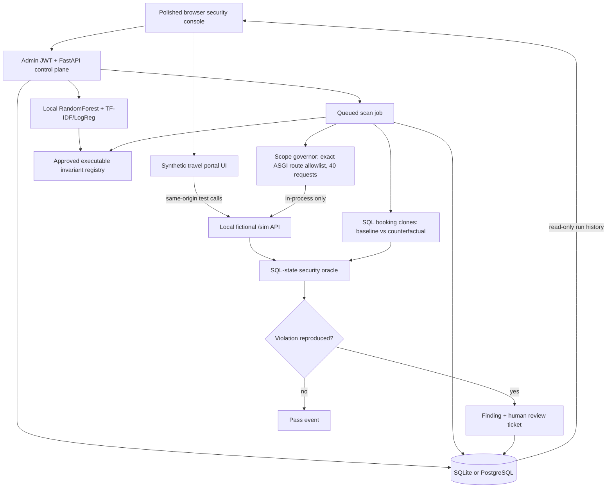

# System design — TripParadox AI PRO

## Trust zones

**Zone A: Security console (browser)** — signed-in admin, **no privileged client-side logic**. Token is stored only in the JavaScript runtime memory. Calls same-origin `/api/*`. No external scripts, fonts, images, analytics or third-party tracking.

**Zone B: Management service (FastAPI)** — JWT issuer, policy enforcement, bootstrap-seeded users, `/api/agent/plan`, `/api/agent/start`, `/api/agent/runs/{id}`, findings, reviews, database health and safety state. Management endpoints are admin gated.

**Zone C: Synthetic travel application (FastAPI `/sim/*`)** — fictional hotel catalog, hold, pay, cancel, booking/refund lookups and planted vulnerabilities. Agent role JWTs determine agency ownership. It is intentionally *not* a real production system.

**Zone D: Security runner (same Python process)** — receives a fixed ASGI object, never accepts a URL from the user, and calls only exact registered synthetic routes. ML models can prioritize and classify cases but can neither bypass approved invariants nor generate arbitrary network requests.

**Zone E: SQL store** — SQLAlchemy ORM with SQLite (default) or optional PostgreSQL. Persists user/account records, agency bookings, refunds, simulated deployments, scan jobs, event telemetry, evidence, findings, inventory observations, review tickets and all audit actions.

## Run timeline (what happens after clicking Run)

1. `GET /api/agent/plan` uses `ml_planner.prioritize()` and returns allowed scenario plan, model scores, schema names and backend function locations. This is a preview; nothing has executed yet.
2. `POST /api/agent/start` atomically sets the fictional deployment state and inserts `deploys`, `scan_runs(status=queued)` and an `audit` event.
3. FastAPI runs `run_pipeline()` as a background task with a **new SQL session**. An `asyncio.Lock` serializes scanning in the documented one-worker deployment.
4. The runner logs a safety envelope in `run_events`. Every outbound synthetic request must pass `SafetyGate`, which checks the kill switch, exact method/path allowlist, budget and request spacing.
5. `train_models()` fits **two actual local models on deterministic synthetic training examples** at startup / first use. A test's risk score and threat classification are stored as JSON. Each test must still be present in an explicitly approved fixture registry.
6. `rebuild_inventory()` combines synthetic gateway records, archived JavaScript and current traffic to label routes active, zombie, shadow. It does not read `/openapi.json` or attempt live external discovery.
7. `fresh_universe()` forks a baseline fictional booking into uniquely labelled SQL clones. `SafeASGI.call()` executes normal and alternate actions using distinct test-role JWTs; both API statuses and actual persisted SQL records are inspected.
8. If a rule is violated, the runner **repeats the test against a new booking clone**. Only repeatable violations generate a finding and an internal review ticket.
9. Every phase stores an immutable-for-demo `run_events` event with Python backend references and non-secret context. The browser polls `/api/agent/runs/{id}` to display it.
10. A secure deployment plus `POST /api/agent/findings/{id}/retest` reruns the exact original invariant and marks it `fixed` only if no violation is found.

## Core SQL tables

- `agencies`, `users`: fictional travel agencies, salted credential hashes, roles.
- `bookings`, `refunds`: booking ledger and cloned parallel-universe transactions.
- `simulator_config`, `deploys`: controlled demo regression flags and version history.
- `scan_runs`, `run_events`: scan lifecycle + frontend timeline provenance.
- `evidence`, `findings`, `tickets`: reproducible proofs, severity, remediation and human review.
- `traffic`, `api_inventory`: synthetic observation/inventory classifications.
- `audit`: named control-plane and scanner request history.

## Explicit limits

This is a complete runnable **vertical slice**, not an enterprise DAST product. No arbitrary URL input or active testing of third-party services, no LLM-powered unrestricted exploit synthesis, no distributed worker fleet, no concurrency-race flaw testing, no actual integrated TBO staging, and no production-grade identity provider. To make this a production platform, formally approve and implement adapter contracts, shared worker locks, durable queueing, migrations, secrets management, test-tenant isolation and independent security review.
