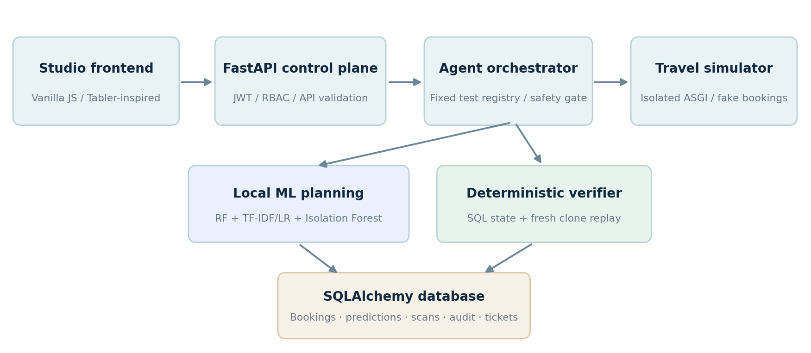
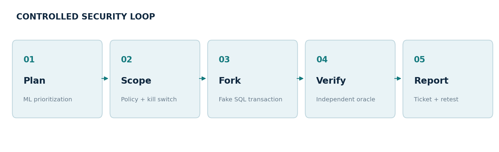
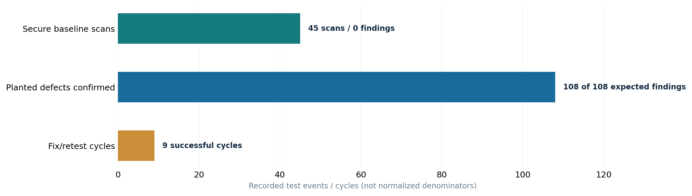

# TRIPPARADOX AI
## Comprehensive Security Engineering, AI Models, Architecture and Verification Report

**Version:** Security-hardened local research prototype  |  **Review date:** 18 November 2026  |  **Report status:** Source-verified, local-test validated, not an independent security certification

**Project category:** Agentic real-time Dynamic Application Security Testing (DAST) for fictional B2B travel transactions. **Scope:** Included synthetic FastAPI travel application only. **External TBO systems:** Not accessed or tested.

**GitHub publication:** NOT YET PUBLISHED. The GitHub account `swarnojit` authenticated in the connector, but no installed repository or repository-creation capability was available. An actual public repository URL will only be inserted after publication and verification. Instructions are supplied in `GITHUB_PUBLICATION.md`.

---

# 1. Executive Decision Brief

TripParadox is a complete local proof-of-concept for **business-invariant security testing**, not a claim of universal automated hacking. The platform reproduces travel-booking actions in isolated database copies, uses three trained local scikit-learn models to order and describe approved tests, executes only allowlisted in-process HTTP requests, and independently verifies booking-state outcomes. Its evidence workflow creates findings only when a suspected violation reproduces against a fresh fictional booking state. The browser then displays the trace, persisted model predictions, findings, remediation recommendations and reviewer tickets.

The practical threat is that an ordinary vulnerability scanner may not recognize cross-step failures such as an agency viewing another agency's booking, a duplicate refund exceeding the original payment, or an old endpoint bypassing current authorization. TripParadox models those outcomes as **business laws that must always hold**, then tests the laws automatically following a simulated software deployment. The system is designed to maximize reliable evidence while preventing unapproved network testing.

### Executive findings

| Assessment area | Verified conclusion | Evidence |
|---|---|---|
| Latest source test suite | **56/56 passed** in a new run during this report preparation | `backend/tests/`, local `pytest -q` |
| Archived independent release gates | Three fresh-database rounds; **45 clean secure scans**, **108/108 planted findings detected**, nine successful patch/retest cycles, zero unfinished jobs | `docs/RELEASE_VERIFICATION_SUMMARY.json`, `docs/release_gate_result.json` |
| Browser and server | Chromium workflow recorded zero JS exceptions; actual local Uvicorn startup/restart passed | `docs/release_browser_result.json`, `docs/release_uvicorn_result.json` |
| Core ML | Three actual local sklearn estimators; **0.8977** synthetic risk ROC-AUC; **0.8166** synthetic threat-classification macro-F1 | `backend/app/services/ml_planner.py`, saved results JSON |
| Secure default | Deliberately defective modes disabled unless explicitly enabled for isolated training | `backend/app/config.py`, `backend/app/main.py` |
| PostgreSQL | SQL schema and Docker Compose compatibility statically assessed; **actual PostgreSQL container NOT run** | `docker-compose.yml`, `docs/POSTGRESQL_SETUP.md` |
| Internet availability | **No public deployment, no live TBO security testing, no GitHub repository published** | Environment and GitHub connector checks |

**Release decision:** PASS for the implemented local demo and its three declared business rules. HOLD for any production or public-internet deployment until live PostgreSQL validation, dependency audits, broader security testing, stronger identity controls and formal authorization are completed. The report does not equate “zero confirmed findings in 45 covered-rule scans” with “zero vulnerabilities.”



# 2. Problem Statement and Objectives

## 2.1 Underlying security problem

Travel platforms combine booking agencies, customers, suppliers, refunds, API gateways, historical service versions and many business rules. A route may individually return valid JSON while the complete customer journey breaks an invariant. Conventional route-by-route checks can therefore leave security-critical business outcomes unnoticed. The TBO-style hackathon asks for rapid post-change security assessment, API inventory, safe proof-of-concept verification, business impact, low noise, human review and retesting.

The solution targets **change-triggered, business-aware regression security**, not raw payload volume. It answers: *If this route or workflow changed, can a bounded set of approved alternate transactions demonstrate that a forbidden business state has become possible?*

## 2.2 Explicit goals

- Prioritize authorized security journeys automatically after a simulated change.
- Reconstruct a bounded synthetic API inventory without relying entirely on an OpenAPI document.
- Execute isolated business transactions under separate fictional agency identities.
- Verify expected versus observed outcomes against committed SQL state, then reproduce on fresh clones.
- Persist model scores, execution phases, evidence, findings, ownership, review tickets and retest outcomes.
- Give human reviewers a usable, visually clear browser console and explainable test history.
- Enforce a hard boundary: **no arbitrary URL entry, no real suppliers, no real customer data, no external scanning**.

## 2.3 Non-goals and boundaries

This prototype does **not** implement unrestricted LLM-driven exploitation, zero-day discovery, every OWASP category, real-time traffic capture from TBO, external target crawling, a production payment gateway, genuine travel partner credentials, enterprise identity/SSO or independently certified security. Three tests are explicitly registered. A real TBO staging adapter must be separately authorized, designed, and tested.

# 3. Delivered Product and User Experience

The deliverable includes an editable source repository, Python backend, static custom frontend, reproducible sklearn models, SQLAlchemy models, isolated simulator, Docker/PostgreSQL configuration, 56 automated tests, test runners, local screenshots and a release assessment. Its **Studio** interface is inspired by the MIT-licensed Tabler admin layout pattern; the application markup and visuals are project-specific and do not copy a commercial travel website.

### Main screens

| Screen | User function | Backend/data source |
|---|---|---|
| Secure sign-in | Log in as admin or fictional agency test identity | `/api/auth/login`; JWT + Argon2 |
| Command center | Show latest runs, findings, API inventory and review workload | `/api/overview`, SQL aggregates |
| Autonomous scanner | Preview the ML-ranked test plan, start a run and follow live progress | `/api/agent/plan`, `/api/agent/start`, `/api/agent/runs/{id}` |
| Model Laboratory | Toggle eight features, inspect risk/novelty/class scores, review held-out metrics | `/api/ml/overview`, `/api/ml/preview`, `/api/ml/predictions` |
| Verified findings | Read reproduced expected/observed proof, severity, owner and recommended fix; retest | `/api/agent/findings`, retest API, SQL evidence |
| API landscape | Inspect synthetic active, zombie and shadow route candidates | `/api/agent/inventory` |
| Travel-booking clone | Browse fictional hotels, hold, pay and cancel; see real test database state | `/sim/catalog`, `/sim/holds`, `/sim/bookings/*` |
| Security and audit | Show configuration review, database dialect/row counts and kill switch | `/api/agent/security-check`, `/api/db/status`, audit |

The frontend uses original HTML, CSS and vanilla JavaScript, avoids external runtime scripts, escapes dynamic values before rendering and stores the signed JWT only in JavaScript memory. The appearance is responsive and supports light/dark mode. Browser UI testing was performed against an in-process FastAPI bridge; the static dashboard screenshots are illustrative unless explicitly accompanied by live test data.



# 4. Architecture, Trust Boundaries and Request Flow

## 4.1 Layered architecture

**Presentation zone:** Same-origin Studio frontend under `/lab` and `/lab-assets/`. The browser submits authenticated API requests and renders a bounded trace. It cannot define an external scan host or arbitrary exploit payload.

**Control-plane zone:** FastAPI routers enforce JWT identity, admin-only scanner/model access, Pydantic input schemas, synthetic deployment state and review decisions. The control plane reserves scan jobs so deployments cannot mutate scenarios while a test is active.

**Machine-learning zone:** A local Random Forest, an NLP classifier and an Isolation Forest calculate scheduling guidance. The planner is restricted to preapproved cases. Predictions are written to `model_snapshots` and `model_predictions` with model version and scan ID.

**Safety/execution zone:** The runner uses HTTPX ASGITransport to call the bundled FastAPI application inside the Python process. An explicit method-and-route allowlist, per-run request budget, spacing, stop flag and sequential execution limit operations. This is not a general HTTP scanner.

**Target zone:** Fictional agency accounts, hotel offers, bookings, payments/refunds and a deliberately vulnerable old API. Security regressions can be enabled only by explicit local lab opt-in.

**Persistence/assurance zone:** SQLAlchemy stores booking universes, refunds, deployments, run events, evidence, findings, tickets and audit entries. The SQL-state verification stage is independent of the ML model's opinions.

## 4.2 End-to-end run sequence

1. An authenticated administrator selects a fictional deployment and opens the **preflight plan**, which identifies the registered cases, model scores and execution constraints.
2. The start endpoint checks the kill switch, permissions and whether a scan/deployment reservation already exists; it records a queued `scan_runs` row.
3. The runner establishes the 40-request local safety envelope; model training objects are initialized or reused from cache.
4. The three models score the preapproved checks; one `model_predictions` record is created for each selected case, linked to the scan.
5. The synthetic inventory reconciles documented routes, archived JavaScript fixtures and mock gateway/observed traffic.
6. A fresh booking universe is created for each case. Different role tokens are used to perform permitted and alternate actions.
7. Requests pass the safety governor and are dispatched to an in-memory ASGI target, never an Internet URL.
8. The oracle compares actual HTTP responses and SQL refund/ownership state against a known invariant; a suspected violation is replayed on a new clone.
9. Only a reproduced violation becomes a `findings` row, `evidence` record and human-review `tickets` item. Every phase is inserted into `run_events`.
10. The UI polls SQL-backed run status. A later secure deployment and targeted retest may mark a finding fixed without destroying its prior evidence.

**Invariant:** ML ranks tests; deterministic application and SQL facts determine whether a vulnerability is proven.

# 5. Artificial Intelligence and Model Engineering

## 5.1 Risk priority model: Random Forest

A `RandomForestClassifier` has 120 estimators, maximum depth seven, minimum leaf size five and a reproducible random seed. It uses **eight binary synthetic endpoint features:** `authorization_boundary`, `financial_mutation`, `legacy_endpoint`, `undocumented_endpoint`, `privileged_operation`, `cross_role_flow`, `write_method`, `recently_changed`.

The training routine generates 1,800 invented feature vectors and corresponding *synthetic* labels through an explicitly coded weighted rule with noise. The stratified split uses 1,350 training and 450 holdout examples. Reported metrics include accuracy, precision, recall, F1, ROC-AUC, Brier score and confusion matrix. The recorded holdout ROC-AUC is **0.8977**, measured only against invented data. Feature importance and single-flag counterfactual sensitivity are visualized in the Model Lab. A score is a **test scheduling heuristic**, not an empirically calibrated real-world probability of exploitation.

## 5.2 Threat-family classifier: TF-IDF + Logistic Regression

The NLP pipeline vectorizes short fictional endpoint descriptions with unigrams/bigrams and then classifies them as `authorization`, `financial_logic` or `legacy_api`. Its source corpus contains ten synthetic phrase families per category and four prefix variants. Eight phrase families per class form training data and two families per class are held out *before* prefix expansion; the split is designed to reduce template leakage. The evaluation comprises 96 generated training strings and 24 holdout strings. Recorded macro-F1 is **0.8166**. This does not establish accuracy on unseen real supplier API language.

## 5.3 Novelty detector: Isolation Forest

A 100-estimator `IsolationForest`, trained on synthetic feature combinations labelled ordinary by the local generator, produces a decision margin. A bounded transform presents that margin as a novelty index and exposes an outlier flag. Unusual combinations invite reviewer attention; the signal is **not** an exploit proof or a known-vulnerability detector. No real-world false-positive or false-negative estimate is available.

## 5.4 Reproducibility and auditability

A deterministic synthetic seed and configuration-derived short hash identify a model build. `model_snapshots` stores evaluation metadata. `model_predictions` stores each case, eight-feature vector, risk score, novelty score, predicted class, confidence, version and explanation, optionally linked to `scan_runs`. A `@lru_cache` avoids retraining on every UI request. No untrusted externally serialized model object is loaded. The model version is a **training-configuration fingerprint, not a cryptographic signature of trained weights**.

## 5.5 ML governance and limitations

The current training data, algorithms and evaluation are real code, but **the labels and endpoints are invented**. The system cannot claim broad autonomous discovery, guaranteed optimal model output or production precision. Before authorized deployment, collect privacy-safe labelled staging traces; use time-based splits and independent holdouts; measure precision/recall per risk class, drift, alert fatigue and detection latency; require human approval for new executable invariants. Never allow a classifier to rewrite allowlists or choose external scan hosts.

# 6. Security Cases and Deterministic Oracles

## 6.1 Cross-agency booking disclosure

**Business law:** Agency B may not read a booking owned by Agency A. **Threat:** a guessable booking identifier and missing object-level ownership enforcement. **Test:** create or select a fictional Agency A booking and make a request with an Agency B token. **Expected:** HTTP 403. **Failure evidence:** unauthorized booking content returned and reproduced on a fresh clone. **Fix:** server-side ownership checks on every object retrieval, not UI filtering. Relevant OWASP category: **API1:2023 Broken Object Level Authorization**.

## 6.2 Duplicate refund and refund conservation

**Business law:** For each fictional booking, total returned value cannot exceed paid value; replaying the same idempotency key cannot cause another credit. **Threat:** timing and retry sequences that cause two financial writes. **Expected:** exact idempotent replay for identical key+amount and rejection when cumulative refund exceeds the original payment. **Failure evidence:** persisted refund rows plus HTTP response reproduce the excess payout.

The hardened secure branch serializes requests by updating the booking row before querying refund state, uses a nullable unique `(booking_id, safe_idempotency_key)` constraint as a database backstop, rejects an identical key used with a different amount, and checks the aggregate cap. The intentionally faulty branch is available only for the isolated opt-in simulator and deliberately omits the secure key to demonstrate detection. Concurrency tests cover 20 same-key requests and 12 different-key requests against a disposable local database. **Real PostgreSQL concurrent performance remains untested.**

## 6.3 Legacy booking authorization parity

**Business law:** A legacy `v1` endpoint must enforce the same agency boundary as the current API. **Threat:** a forgotten route, disclosed through archived frontend code or synthetic traffic, bypasses a newer authorization layer. **Test:** request another agency's booking through the legacy route using the wrong agency token. **Expected:** HTTP 403. **Failure:** old route returns booking data and the independent clone reproduces it. **Fix:** share one authorization policy across versions, then decommission unused paths.

## 6.4 Why the proof is stronger than an ML alert

The system checks actual synthetic HTTP/SQL state; keeps the expected rule in a fixed registry; reproduces failure on a fresh booking; stores expected versus observed states; and generates a review ticket containing a recommended correction. The model cannot simply declare a finding based on its score. This reduces noise **within the three registered scenarios**, but does not demonstrate field-wide false-positive performance.

# 7. API Inventory and Post-Change Planning

The inventory service compares fixture-driven documented routes, archived JavaScript references, mock gateway observations and actual synthetic app activity. It labels route candidates **active** (known usage), **zombie** (older reachable route with little or no recent legitimate traffic), or **shadow** (observed but absent from approved documentation). The frontend exposes classification, owner and recommended action.

A changed-route planner selects relevant approved checks instead of always executing every check. Changes, decisions and event timestamps are SQL-persisted. The inventory is **a functioning fixture-backed demonstration, not proof of real undisclosed TBO API discovery**. Genuine deployment instrumentation would require an authorized traffic feed, named owners, retention controls and server-side normalization of route templates.

# 8. Data Architecture and PostgreSQL Design

## 8.1 Persistent entities

| Data domain | Tables | Security purpose |
|---|---|---|
| Identity | `agencies`, `users` | Fake agency membership, salted Argon2 password hashes and role linkage |
| Booking ledger | `bookings`, `refunds` | Counterfactual transaction states and payment-conservation evidence |
| Simulator change control | `simulator_config`, `deploys` | Versioned flaw toggles, kill switch and approved synthetic scenarios |
| Scan orchestration | `scan_runs`, `run_events` | Persistent status, phases, request totals and reproducible execution records |
| ML governance | `model_snapshots`, `model_predictions` | Training metadata, feature vectors, predictions and scan linkage |
| Assurance | `evidence`, `findings`, `tickets` | Oracle observations, severity, owner, recommendation and human review |
| Discovery and accountability | `traffic`, `api_inventory`, `audit` | Route observations, asset inventory and action log |

The default local run uses SQLite for simplicity; Docker Compose points SQLAlchemy to PostgreSQL 17 via `postgresql+psycopg`. The Compose configuration creates a PostgreSQL admin and a separate non-superuser app login, persists a named data volume, binds the web UI to **127.0.0.1:8000** and leaves the database port unpublished. The application performs parameterized ORM queries. This was statically reviewed, but an actual PostgreSQL server, migrations and rollback were **not** exercised in the current environment.

## 8.2 Transaction integrity details

`refunds.safe_idempotency_key` is nullable to distinguish the deliberately vulnerable laboratory branch from secure-mode financial writes. A booking/key uniqueness constraint is created; the application locks the booking row by issuing an update before the aggregate refund decision. A narrow startup migration adds the column/index to an older demo schema and widens `tickets.state` to accommodate long review states in PostgreSQL. This migration is **not an enterprise migration system**; operational deployment should use versioned Alembic migrations, backups, rehearsal on staging and rollback instructions.

## 8.3 Data protection and retention

Only fake records belong in this database. Application tokens or passwords should never be written into the report or audit trail. SQL reads of findings, inventory, model predictions and audit are admin-gated; human reviewers should have a distinct role in future. There is no formal purge/retention schedule, tamper-evident ledger, at-rest encryption policy or SIEM integration; these remain implementation gaps.

# 9. Identity, Application and Runtime Security Controls

| Control | Implemented method | Assurance / limitation |
|---|---|---|
| Credentials | Bootstrap-generated secrets; Argon2 password hashing; secrets in ignored `.env` | No vault, rotation service or external identity provider |
| Session | HS256 signed JWT, 40-minute expiry, audience, role and agency consistency | No centrally revocable session/SSO |
| Authorization | Admin-only control plane; per-agency booking ownership | Only fictional test identities; intentional regressions gated |
| Network scope | HTTPX in-memory ASGI transport and fixed path/method allowlist | Not a general authorized remote scanner |
| Execution quota | 40 requests maximum, sequential spacing, persistent kill switch | In-flight request may finish on stop; wider limits need review |
| Abuse limitation | Basic in-process login-failure throttling | Not suitable for multi-worker distributed use |
| Browser headers | CSP, nosniff, frame denial, no-store, referrer, permissions and host restrictions | Independent browser security review still necessary |
| Input validation | Typed schemas with extra fields forbidden in sensitive operations | Input fuzzing outside covered cases not performed |
| SQL integrity | SQLAlchemy ORM, unique key, guarded refund transaction | PostgreSQL live concurrency tests outstanding |
| Runner isolation | One-worker local deployment, durable status reservation, failure events | Distributed queues and locks not implemented |
| Container baseline | Non-root user, read-only app filesystem, dropped capabilities, limited PIDs, health checks | Docker runtime checks not performed |
| Human governance | Named reviewer ticket and audit trail | Demo admin/reviewer duties not fully segregated |

The application uses TrustedHostMiddleware for local hostnames. Setting `TP_ALLOW_INTENTIONAL_FLAWS=false` prevents opening deliberately faulty scenarios and resets leftover faulty flags when the app starts. Do not interpret the secure default as readiness for untrusted public traffic.

# 10. Hardened Defects: Root Cause, Fix and Evidence

| Observed engineering issue | Root cause / failure mode | Implemented correction | Verification |
|---|---|---|---|
| Double refund race | Check-then-write sequence insufficient for concurrent requests | Lock booking row, check idempotency, cap aggregate and add DB unique key | 20 same-key / 12 distinct-key concurrent tests |
| Unsafe training mode persisted | Old DB flags could remain enabled after restart | Explicit `TP_ALLOW_INTENTIONAL_FLAWS` opt-in, disable flags on secure boot | Secure-default reboot tests |
| Deployment/scan overlap | Scenario could change while an active run was evaluating it | SQL-backed scan reservation and active job conflict checks | Concurrent reservation integration tests |
| Preflight failure stranded job | ML initialization error occurred before run finalizer | Controlled error wrapper persists failure and audit | Fault-injection test |
| Ticket state too narrow | VARCHAR length did not accommodate escalation-state value | Widen to 48 and narrow demo schema migration | Schema and old-SQLite migration tests; PG live untested |
| Missing attempted-request audit | Failed local ASGI call could exit before normal log write | Record attempted call/exception; stop on 429 and 5xx | Fault injection for exception/503 |
| Unexpected JSON attributes | Loose schema permitted unknown fields in some operations | Forbid extra properties with strict Pydantic models | Invalid payload negative tests |
| Excessive container privileges | Initial container ran as root with writable FS | Non-root UID, read-only FS, cap drop, tmpfs and health check | Compose review only; actual runtime not validated |
| Dependency drift | Unbounded direct library upgrades affected reproducibility | Pin locally verified direct Python versions | Full suite repeated; CVE scan remains unperformed |

The review intentionally preserves synthetic flaw toggles to validate detection, but they are disabled by default and must never be enabled on a reachable public host.

# 11. Verification Methodology and Measured Outcomes

## 11.1 Evidence hierarchy

**Highest confidence in this report:** freshly rerun local pytest source suite (56/56), plus saved machine-readable output from three independent release gates. **Supporting confidence:** browser-bridge workflow, actual Uvicorn HTTP boot/restart, syntax validation and PostgreSQL Compose static checks. **Not assessed:** real PostgreSQL runtime, untrusted external network deployment, full dependency vulnerability audit and real TBO systems.



## 11.2 Repeated release-gate methodology

Each gate initialized a **fresh temporary SQLite database and random test-only secrets**. A gate ran 15 secure-mode scans (expected zero violations); 12 deliberately vulnerable scans (expected three known findings each); and three fix/retest sequences (retest expected clean). It also checked persisted `model_predictions`, required event phases, the 40-request cap, source-independent model evaluation metadata and absence of queued/running jobs at completion. **Three separate gate rounds** resulted in 45 secure scans, 108 detected out of 108 intentionally seeded findings, nine fixed outcomes and zero unfinished jobs.

The recorded aggregate mean for a full synthetic scan was approximately **0.4168 seconds**, with maximum **0.9207 seconds** across those runs. These are tiny in-process test cases on local data, not a scale/load benchmark or production incident-response latency.

## 11.3 Repeated tests and negative controls

The 56-test suite covers: 403 role restrictions, expired/forged token behavior, secure refund idempotency, simultaneous refunds with same/different keys, payments and cancellations, API allowlist rejection, admin kill switch, strict binary ML input validation, model result bounds, persisted evidence, model snapshots, inventory classification, failure recovery, scan reservations, browser asset serving and server security headers. Negative controls (planted bugs still being detected) matter because a system that never reports anything can trivially appear to have zero vulnerabilities.

## 11.4 Browser and real server evidence

An isolated Chromium workflow exercised sign-in, model feature preview, fictional hotel holds, secure scanning, planted defect detection, database status, theme and mobile drawer with **zero recorded JavaScript exceptions**. A separate real local Uvicorn process verified JWT/DB health, API responses, safe and planted scans, graceful shutdown and persistence after restart using SQLite. This is stronger than syntax testing alone, but does not substitute for a real Docker/PostgreSQL rollout.

## 11.5 Model evaluation interpretation

Risk ROC-AUC **0.8977** and threat macro-F1 **0.8166** come from deterministic synthetic holdout sets. No independent real-world exploit labels were available. There is no statistically defensible claim of 0% false positives, 100% recall, zero unknown vulnerabilities or universally optimal AI output. Future staging evaluation needs a labelled confusion matrix by vulnerability type and a separate red-team corpus.

# 12. Security Standards and Coverage Mapping

This prototype aligns partially with the *ideas* in established standards; it has **not** been audited or certified against them.

| External baseline | Relevant expectation | TripParadox evidence | Gap |
|---|---|---|---|
| OWASP API Security Top 10 2023 — API1 BOLA | Enforce object-level authorization | Cross-agency invariant, tenant checks, old-route regression | Other object properties/routes not exhaustively tested |
| OWASP API3 Broken Object Property Level AuthZ | Restrict unexpected properties | Strict schemas, extra-field negative tests | Broad response-property review unperformed |
| OWASP API4 Unrestricted Resource Consumption | Control resource use | Hard 40-request budget, sequential spacing, kill switch | Distributed resource budgeting and load testing absent |
| OWASP API9 Improper Inventory Management | Identify shadow/legacy APIs | Fixture-backed active/zombie/shadow classification | No real production traffic crawler/instrumentation |
| OWASP ASVS 5.0 | Verification of authentication, API, input and data controls | Auth, headers, validation, logging tests | No complete ASVS requirement-by-requirement audit |
| NIST SSDF SP 800-218 | Establish repeatable secure development process | Automated tests, model audit, CI, reproducible release gates | Missing formal threat review approval, SBOM, signed release and vulnerability process |

Source links: OWASP API Security Top 10 (2023): https://api-security.owasp.org/editions/2023/en/0x11-t10/ ; OWASP ASVS 5.0: https://asvs.owasp.org/ ; NIST SSDF SP 800-218: https://csrc.nist.gov/pubs/sp/800/218/final .

# 13. Deployment Architecture and Release Runbook

## 13.1 Preferred local deployment

The repository contains `docker-compose.yml` with PostgreSQL 17, a separate non-superuser app database role, named volume, Postgres readiness probe and a FastAPI service bound to `127.0.0.1:8000`. The app container uses a non-root UID, one Uvicorn worker, read-only root FS, a small temporary mount and disabled Linux capabilities. It is **a demonstration architecture**; the actual Docker/PostgreSQL boot has not been executed or validated.

Run from a freshly extracted project after checking scripts and dependencies:

```bash
python scripts/bootstrap.py
python -m pip install -r backend/requirements-dev.txt
cd backend && python -m pytest tests -q && cd ..
docker compose up --build -d
docker compose ps
docker compose logs app --tail 80
# Open http://127.0.0.1:8000/health/db; expect database=postgresql
```

**Alternative without Docker:** `python scripts/run_backend.py` after bootstrap; the status endpoint should report `sqlite`.

## 13.2 Mandatory deployment decision gates

**Before any internet-facing integration:** obtain written authorization and precise stage target/path allowlists; replace demo accounts and browser auth model with managed identity; isolate injected-flaw modes from production code and deployment; run real PostgreSQL migrations, integration/concurrency tests, backups and recovery; rotate secrets; implement TLS termination, distributed rate limit, telemetry and SIEM; scan dependency CVEs and generate an SBOM; complete OWASP ASVS/DAST and independent penetration testing; define human response owners. None of these conditions is waived by a passing local unit suite.

## 13.3 Incident and rollback procedure

If the simulator appears unsafe, **disable test-mode flaws**, activate the persisted stop switch, isolate the process, preserve audit and run events, and halt further scans. For database rollback, back up the PostgreSQL volume and review schema migrations first. `docker compose down` retains data; `docker compose down -v` destroys the named database volume and should not be used casually. A failed scan should end in a persisted error rather than silently remaining active.

## 13.4 CI/CD

The included GitHub Actions workflow runs pytest, Python bytecode compilation and Node.js syntax checks on push/pull request. It does **not** currently run an external dependency vulnerability scanner, an SBOM generator, a production Postgres instance, browser tests or continuous staging approval gates. Those should be explicit required checks before release.

# 14. Outstanding Risk Register

| Priority | Remaining risk | Why it matters | Next control / acceptance test |
|---|---|---|---|
| **P0 before production** | Real PostgreSQL deployment not tested | SQL migration/lock semantics can differ from SQLite | Launch Compose on fresh and upgraded Postgres; concurrent refund/load test |
| **P0 before production** | No authorized TBO staging adapter | Demo is not a measured real-world scanner | Written scope, synthetic accounts, dedicated staging ingestion |
| **P0 before production** | Unknown attack classes not covered | Only three registered invariants | Approved invariant expansion, threat-led independent pentest |
| **P0 before production** | Deliberately vulnerable test branches in app source | Operator can accidentally expose test defects | Compile/package simulator separately; prohibit remote access |
| **P1** | No SSO, JWT revocation, MFA, central login rate limits | Long-running sessions and multi-worker access risk | Managed identity, centralized revocation and shared limits |
| **P1** | Dependency CVEs/SBOM not assessed | Third-party packages can contain known flaws | `pip-audit`, OS image scan, SBOM and versioned upgrade policy |
| **P1** | No full data retention/immutable audit | Investigation integrity and privacy management | Retention limits, redaction, access control, tamper-evident exports |
| **P1** | No distributed worker and queue safety | At-scale scan reservations may race | Durable queue and DB/Redis-backed locks, idempotent retries |
| **P2** | ML trained only on invented examples | Real-world scores can be misleading | Real labelled staging corpus, independent validation and drift monitoring |
| **P2** | Model explanations are sensitivity heuristics | Could be mistaken for causation | Document limitations, log model version and add formal explainability review |
| **P2** | Incomplete observability/load tests | Restart path passed but scale unknown | Traffic simulation, resource dashboards, chaos/restart testing |

**Risk disposition:** Local education/hackathon demo can proceed with strict isolation; no sign-off for live production or real supplier testing.

# 15. Roadmap to an Authorized Pilot

**Phase 0 — Reproducible baseline:** keep the 56 regression checks and 3-round release gate; automate clean boot, environment checks, secret scanning and CI branch protection. Deliverable: signed benchmark report and release tag.

**Phase 1 — Real database and DevSecOps:** test PostgreSQL on Docker with concurrent refunds, snapshot/restore and migration rollback; add `pip-audit`, OS scanner, SBOM and SAST; publish CI results. Deliverable: green compose integration and dependency review.

**Phase 2 — Approved staging data:** obtain written authorization for specific synthetic staging endpoints; ingest documented gateway samples and CI change events; disable unsafe scenarios in stage artifacts. Deliverable: scoped API inventory reconciliation and controlled traffic budgets.

**Phase 3 — Broader business invariants:** add cancellation/refund cross-service logic, multi-agency role transitions, stale inventory and payment reconciliation with deterministic validation. Deliverable: seeded benchmark with precision/recall and false-positive analysis.

**Phase 4 — Human-review operation:** separate analyst and approver identities, introduce triage SLA, tamper-evident proof exports, audit retention, dashboard alert tuning and patch/retest automation. Deliverable: documented runbook and independent review.

## Success criteria for the pilot

Measure reproducible true-positive rate against a **labelled** planted-defect corpus, false findings per deployment, time from authorized change to reviewed proof, requests per run, API inventory recall against a known fixture truth set, mean retest time, zero out-of-scope requests, and time to safely stop. Do not use the synthetic local 108/108 number as a production recall rate.

# 16. Hackathon Fit and Presentation Narrative

This project is intended to demonstrate **change-aware security with verifiable business impact**. Its distinct idea is a **counterfactual transaction time machine**: two isolated fake booking universes are compared under the same rules, and a violation is not reported until it reproduces. The three local models make that process more efficient and explainable, but the proof layer remains deterministic. A polished browser trace lets judges see that the algorithm did real work rather than just generating recommendations.

The submitted challenge brief prioritizes valid findings and severity, precision/noise, safety, speed, report quality and API inventory. TripParadox is strongest on **safe bounded proof and explainability** within the demo, demonstrates inventory/change planning on fixtures, and remains weaker on general unknown-vulnerability coverage and real traffic integration. Present those distinctions transparently.

Suggested live demonstration: sign in; show Model Lab; preview selected scenario and its risk/novelty scores; start secure run (zero findings); enable the isolated planted regression (three findings); inspect a refund proof and its SQL event history; switch back to secure release, retest and show the fixed ticket; finish with security controls and limits. Never run the planted mode on a public Internet deployment.

# 17. GitHub Publication, Code Ownership and Verification

**Current status:** The code has been prepared as a GitHub-ready repository, with `.gitignore`, `.env.example`, `LICENSE`, documentation, test scripts, CI workflow and publishing helper. The GitHub tool authenticated the user `swarnojit`, but returned **zero authorized GitHub App installations and no accessible repositories**. Its available actions could update an existing permitted repository, but not create a new one. Thus **no public repository URL is verified or embedded here**.

To publish, install GitHub CLI (`gh`), authenticate, and run the included `scripts/publish_public_github.sh` on a trusted workstation. That script checks the secret exclusions, initializes Git if necessary, creates a new public repository and pushes the `main` branch. On success, record the **actual URL returned by GitHub**, verify that the published default branch contains the code and this report, and then update this section before sharing the report publicly.

**Public release restrictions:** `.env`, database files, backup dumps, session tokens, real user data, passwords, supplier API credentials and unreviewed secrets must never be committed. The included synthetic fixtures and screenshots contain no real customer transactions. A permissive MIT license exists in the repository; independently confirm rights for any subsequently added third-party assets.

# 18. Reproduction Commands and File Navigator

```bash
# From repository root
python scripts/bootstrap.py
python -m pip install -r backend/requirements-dev.txt
cd backend && python -m pytest tests -q && cd ..
python scripts/verify_release.py --safe 12 --planted 9 --fixes 3
python scripts/verify_secure_default.py
python scripts/verify_server.py
# Optional Chromium verification in isolated local environment
python scripts/verify_browser.py
node --check backend/app/static/app.js
python -m compileall -q backend/app
```

| Evidence or implementation | Repository path |
|---|---|
| Frontend login/dashboard/scanner/model lab | `backend/app/static/index.html`, `app.js`, `styles.css` |
| Signed JWT and roles | `backend/app/auth.py` |
| Input schemas and API routes | `backend/app/schemas.py`, `backend/app/routers/api.py` |
| Synthetic hotel, booking, refund, legacy API | `backend/app/routers/simulator.py` |
| AI estimators and holdout evaluation | `backend/app/services/ml_planner.py` |
| Model history persistence | `backend/app/services/model_registry.py` |
| Agent and SQL-state replay | `backend/app/services/engine.py` |
| Exact network safety governor | `backend/app/services/safety.py` |
| API inventory adapter | `backend/app/services/inventory.py` |
| SQL tables and demo migration | `backend/app/models.py`, `backend/app/migrations.py` |
| Docker/PostgreSQL services | `docker-compose.yml`, `backend/Dockerfile` |
| Expanded automated security tests | `backend/tests/test_release_hardening.py` and other test files |
| Release gate / browser / server results | `docs/RELEASE_VERIFICATION_SUMMARY.json`, `docs/release_browser_result.json`, `docs/release_uvicorn_result.json` |
| GitHub publishing instructions | `GITHUB_PUBLICATION.md` |

# 19. Evidence Register and References

**Primary internal evidence — directly recovered and inspected:** `README.md`; `docs/RELEASE_SECURITY_REPORT.md`; `docs/RELEASE_VERIFICATION_SUMMARY.json`; `docs/release_gate_result.json`; `docs/release_browser_result.json`; `docs/release_uvicorn_result.json`; `docs/MODEL_ENGINEERING_DEEP_DIVE.md`; `docs/POSTGRESQL_SETUP.md`; `backend/tests/`; `backend/app/`; `docker-compose.yml`. A new local 56/56 pytest run was performed during this report generation. The earlier three release-gate result sets are recovered test artifacts, not independently rerun three times in this particular report session.

**External technical references (standards/guidance, not proof that TripParadox complies):**

- OWASP, **API Security Top 10: 2023**, https://api-security.owasp.org/editions/2023/en/0x11-t10/
- OWASP, **API1 Broken Object Level Authorization**, https://api-security.owasp.org/editions/2023/en/0xa1-broken-object-level-authorization/
- OWASP, **Application Security Verification Standard 5.0**, https://asvs.owasp.org/
- NIST, **SP 800-218 Secure Software Development Framework**, https://csrc.nist.gov/pubs/sp/800/218/final
- HTTPX, **ASGI in-process transports**, https://www.python-httpx.org/advanced/transports/
- PostgreSQL documentation, https://www.postgresql.org/docs/
- SQLAlchemy documentation, https://docs.sqlalchemy.org/
- scikit-learn documentation, https://scikit-learn.org/stable/

---

**Final statement:** TripParadox demonstrates a repeatable, bounded, well-instrumented security testing prototype with three local ML models and independent SQL-state proofs. Its saved repeat testing provides evidence that the three known secure rules continue to pass, while known planted regressions are detected. **No claim of zero vulnerabilities, production readiness, live PostgreSQL validation, or public GitHub publication is made.**
